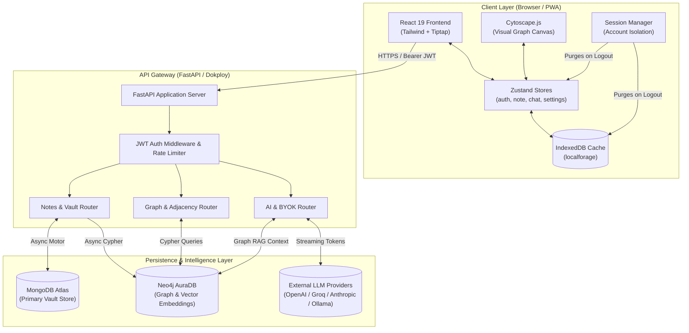
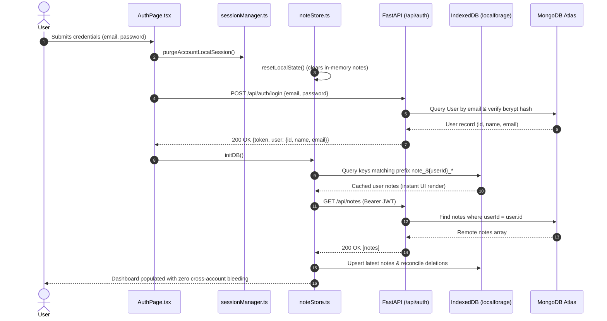
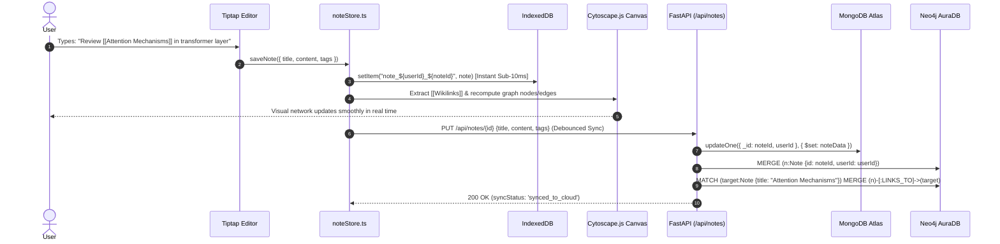
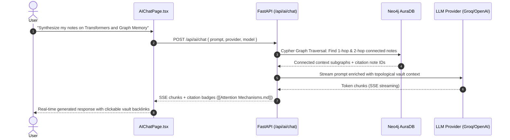

# 📐 NoteRoot AI — System Architecture & Data Flow (`flow.md`)

This document provides a deep-dive architectural analysis of NoteRoot AI, detailing system topology, state synchronization pipelines, database schemas, and end-to-end data flows designed for technical leads, system architects, and technical interviewers.

---

## 1. System Architecture Overview

NoteRoot AI is architected as an **offline-first, hybrid cloud-synchronized system** composed of three distinct operational tiers:

```
[ Client PWA Tier ]          [ Application Tier ]            [ Distributed Persistence ]
  React 19 + TypeScript        FastAPI (Python 3.12)           MongoDB Atlas (Document Store)
  Zustand v5 State             Pydantic v2 Validation          Neo4j AuraDB (Graph & Vectors)
  IndexedDB (localforage)      Async Motor & Neo4j Drivers     LLM Providers (OpenAI/Groq/Claude)
  Cytoscape.js Engine          JWT HS256 Authentication        Docker Swarm / Dokploy PAAS
```

1. **Client Tier (PWA):**
   - **Local Storage Engine:** Implements `localforage` over browser IndexedDB with deterministic key-space segregation (`note_${userId}_${noteId}`) ensuring sub-10ms instantaneous read/writes and full offline editing capability.
   - **Canvas & Graph View:** Tiptap v3 block editor handles rich markdown parsing, KaTeX mathematical formulas, and Mermaid diagrams. Cytoscape.js maintains a dynamic 2D force-directed knowledge graph calculated client-side from bi-directional `[[Wikilinks]]`.
   - **State Hydration:** Five modular Zustand stores manage authentication, note tree models, real-time sync queues, chat conversations, and plugin sandboxing.

2. **Application Tier (FastAPI Gateway):**
   - Asynchronous Python microservice deployed via Docker on Dokploy.
   - Handles token validation, password hashing (`passlib`/bcrypt), note lifecycle CRUD, rate-limiting (`slowapi`), and proxying requests to external AI model providers (OpenAI, Anthropic, Gemini, Groq, local Ollama).
   - Manages asynchronous graph ingestion: parses document contents, extracts entities and links, and updates topological subgraphs in Neo4j.

3. **Persistence Tier (Dual-Database Topology):**
   - **MongoDB Atlas:** Serves as the primary operational document database storing user credentials, note contents, space categorizations, and marketplace plugin metadata.
   - **Neo4j AuraDB:** Serves as the relational knowledge graph and vector store. Nodes represent notes (`:Note`), and directed edges represent bidirectional wikilinks (`[:LINKS_TO]`), enabling multi-hop Graph RAG retrieval.

---

## 2. System Architecture Topology Diagram



---

## 3. End-to-End User Journey Flows

### Flow A: Authentication & Isolated Vault Hydration


### Flow B: Note Authoring, Wikilink Extraction & Graph Sync


### Flow C: Graph RAG (Retrieval-Augmented Generation) AI Query


---

## 4. Client State Architecture & Lifecycle

The client application utilizes five segregated **Zustand v5** stores with middleware persistence:

| Store Name | Responsible Module | Persistence Target | State Scope & Responsibilities |
| :--- | :--- | :--- | :--- |
| `useAuthStore` | [`authStore.ts`](client/src/stores/authStore.ts) | `localStorage` (`noteroot-auth`) | JWT token, active user profile (`id`, `name`, `email`), login/signup/logout actions. |
| `useNoteStore` | [`noteStore.ts`](client/src/stores/noteStore.ts) | `IndexedDB` (`vault`) | In-memory notes collection, sync queues (`idle`, `saving_locally`, `synced_to_cloud`), active spaces. |
| `useChatStore` | [`chatStore.ts`](client/src/stores/chatStore.ts) | `localStorage` (`noteroot-chat`) | Conversation history, active chat threads, per-note conversation associations. |
| `useSettingsStore` | [`settingsStore.ts`](client/src/stores/settingsStore.ts) | `localStorage` (`noteroot-settings`) | Theme (`dark`/`light`), BYOK API keys (OpenAI, Anthropic, Gemini, Groq), active models. |
| `usePluginStore` | [`pluginStore.ts`](client/src/stores/pluginStore.ts) | `IndexedDB` (`installed_plugins`) | Built-in and community plugin manifests, active UI slot extensions, runtime sandboxing. |

### Session Isolation & Purging Mechanism
To guarantee enterprise-grade data isolation when switching accounts on shared devices:
1. `performLogout()` invokes `purgeAccountLocalSession()`.
2. `useNoteStore.getState().resetLocalState()` drops all notes from RAM (`notes: []`).
3. `useChatStore.getState().clearAll()` drops all conversation threads.
4. User-specific keys (`noteroot_starred_ids`, `noteroot_expanded_spaces`, `noteroot_open_tabs`) are purged from `localStorage`.
5. IndexedDB records remain prefixed with `note_${userId}_` and are unreachable by any subsequent unauthenticated or newly logged-in user.

---

## 5. Database Schema & Relational Map

### 5.1 MongoDB Collections (Document Tier)

#### Collection: `users`
| Field | Type | Modifiers / Index | Description |
| :--- | :--- | :--- | :--- |
| `_id` | `ObjectId` | Primary Key | Unique user identifier |
| `name` | `string` | Trimmed | User's display name |
| `email` | `string` | Unique Index | Normalized user email |
| `password` | `string` | Hashed | Salted bcrypt password hash |
| `settings` | `object` | Embedded | User preferences, active provider, synced community plugin IDs |
| `createdAt` | `datetime` | Default now | Registration timestamp |

#### Collection: `notes`
| Field | Type | Modifiers / Index | Description |
| :--- | :--- | :--- | :--- |
| `_id` | `string` (UUID) | Primary Key | UUID generated client-side for offline creation |
| `userId` | `string` | Indexed | Foreign Key linking to `users._id` |
| `title` | `string` | Indexed | Note title (used for `[[wikilink]]` targeting) |
| `content` | `string` (HTML/MD) | Text Search | Rich document contents |
| `tags` | `array<string>` | Multikey Index | Organizational hashtags (e.g. `#research`, `#ai`) |
| `parentId` | `string \| null` | Nullable | Parent note ID for hierarchical tree nesting |
| `space` | `string` | Default: "Other" | Categorical workspace bucket (e.g., "Architecture") |
| `icon` | `string` | Default: "📄" | Note icon or emoji |
| `properties` | `object` | Flexible dict | Arbitrary key-value metadata |
| `updatedAt` | `datetime` | Indexed | Epoch timestamp for conflict-free resolution |
| `createdAt` | `datetime` | Immutable | Creation timestamp |

---

### 5.2 Neo4j AuraDB Graph Topology

```
(:User {id: $userId})
    |
    |--[:OWNS]--> (:Note {id: $noteId, title: $title, userId: $userId})
                    |
                    |--[:LINKS_TO]--> (:Note {id: $targetId, title: $targetTitle})
                    |
                    |--[:TAGGED_WITH]--> (:Tag {name: $tagName})
```

- **Nodes:**
  - `(:Note {id: STRING, title: STRING, userId: STRING, embedding: LIST<FLOAT>})`
  - `(:Tag {name: STRING})`
- **Relationships:**
  - `(:Note)-[:LINKS_TO {createdAt: DATETIME}]->(:Note)`: Directed bi-directional backlink.
  - `(:Note)-[:TAGGED_WITH]->(:Tag)`: Semantic grouping node for graph cluster detection.

---

## 6. API Endpoints Map

All protected routes require an `Authorization: Bearer <JWT>` header.

| Endpoint | Method | Auth | Description | Request Payload / Params | Response |
| :--- | :---: | :---: | :--- | :--- | :--- |
| `/api/health` | `GET` | Public | System and database health check | None | `{"status": "ok", "message": "..."}` |
| `/api/auth/signup` | `POST` | Public | Create new user account | `{"name": "...", "email": "...", "password": "..."}` | `200 OK {"token": "...", "user": {...}}` |
| `/api/auth/login` | `POST` | Public | Authenticate existing user | `{"email": "...", "password": "..."}` | `200 OK {"token": "...", "user": {...}}` |
| `/api/auth/me` | `GET` | Bearer | Fetch authenticated user profile | None | `200 OK {"id": "...", "name": "...", "email": "..."}` |
| `/api/auth/settings` | `PUT` | Bearer | Update user settings & provider config | `{"theme": "...", "activeProvider": "..."}` | `200 OK {"success": true}` |
| `/api/notes` | `GET` | Bearer | Retrieve all user notes for sync | Query: `?space=...&tag=...` | `200 OK [NotePayload, ...]` |
| `/api/notes` | `POST` | Bearer | Create or sync new note to cloud | `NotePayload` (`title`, `content`, `tags`, etc.) | `201 Created NotePayload` |
| `/api/notes/{id}` | `GET` | Bearer | Fetch single note by UUID | Path: `id` (UUID) | `200 OK NotePayload` |
| `/api/notes/{id}` | `PUT` | Bearer | Update existing note | Path: `id`, Body: `NotePayload` | `200 OK NotePayload` |
| `/api/notes/{id}` | `DELETE` | Bearer | Delete note from Mongo and Neo4j | Path: `id` | `200 OK {"success": true}` |
| `/api/graph` | `GET` | Bearer | Cytoscape-formatted graph nodes & edges | None | `200 OK [ {data: {id, label}}, {data: {source, target}} ]` |
| `/api/ai/chat` | `POST` | Bearer | Stream contextual Graph RAG completion | `{"prompt": "...", "provider": "...", "model": "..."}` | `Text Stream (Server-Sent Events)` |
| `/api/plugins/marketplace` | `GET` | Public | Fetch verified community plugin listings | None | `200 OK [PluginManifest, ...]` |

---

## 7. Security & Privacy Guarantees

1. **Local Data Sovereignty:** Data written by the user resides in client-side IndexedDB. Offline usage produces zero outbound network transmissions.
2. **Zero Model Training:** In accordance with NoteRoot AI's privacy principles, user vaults are never leveraged for LLM pre-training or fine-tuning.
3. **Cryptographic Salted Hashing:** User passwords are encrypted with industry-standard bcrypt hashing prior to storage in MongoDB Atlas.
4. **State Isolation:** Session logout enforces memory wiping, drop of chat stores, and key namespace boundaries, guaranteeing shared hardware privacy.
