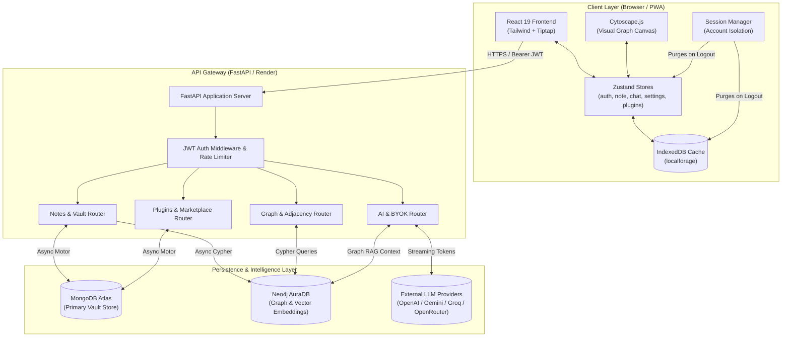
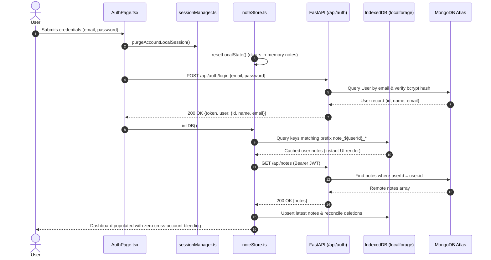
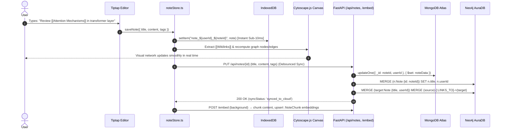
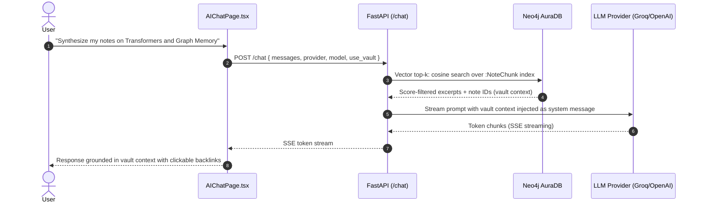

# 📐 NoteRoot AI — System Architecture & Data Flow (`flow.md`)

This document provides a deep-dive architectural analysis of NoteRoot AI, detailing system topology, state synchronization pipelines, database schemas, and end-to-end data flows designed for technical leads, system architects, and technical interviewers.

---

## 1. System Architecture Overview

NoteRoot AI is architected as an **offline-first, hybrid cloud-synchronized system** composed of three distinct operational tiers:

```
[ Client PWA Tier ]          [ Application Tier ]            [ Distributed Persistence ]
  React 19 + TypeScript        FastAPI (Python 3.12)           MongoDB Atlas (Document Store)
  Zustand v5 State             Pydantic v2 Validation          Neo4j AuraDB (Graph & Vectors)
  IndexedDB (localforage)      Async Motor & Neo4j Drivers     LLM Providers (OpenAI-compatible)
  Cytoscape.js Engine          JWT HS256 Authentication        Render (Docker) · Vercel (CDN)
```

1. **Client Tier (PWA):**
   - **Local Storage Engine:** Implements `localforage` over browser IndexedDB with deterministic key-space segregation (`note_${userId}_${noteId}`) ensuring sub-10ms instantaneous read/writes and full offline editing capability.
   - **Canvas & Graph View:** Tiptap v3 block editor handles rich markdown parsing, KaTeX mathematical formulas, and Mermaid diagrams. Cytoscape.js maintains a dynamic 2D force-directed knowledge graph calculated client-side from bi-directional `[[Wikilinks]]`.
   - **State Hydration:** Five modular Zustand stores manage authentication, note tree models, real-time sync queues, chat conversations, and plugin sandboxing.

2. **Application Tier (FastAPI Gateway):**
   - Asynchronous Python service deployed as a single Docker container on Render (`render.yaml`, one gunicorn worker).
   - Handles token validation, password hashing (bcrypt), note lifecycle CRUD, rate-limiting (`slowapi`), and proxying to OpenAI-compatible AI providers (OpenAI, Gemini, Mistral, Groq, OpenRouter — BYOK keys or server-side defaults) with optional web search (Tavily, Brave, SearXNG).
   - Maintains the knowledge graph: extracts `[[Wikilink]]` edges from note content, upserts `:Note`/`:NoteChunk` nodes, and keeps vector indexes in sync on every note save.

3. **Persistence Tier (Dual-Database Topology):**
   - **MongoDB Atlas:** Primary operational database storing user credentials (bcrypt hashes), AES-GCM-encrypted BYOK provider keys, note contents, and marketplace plugin metadata.
   - **Neo4j AuraDB:** Relational knowledge graph and vector store. Nodes represent notes (`:Note`) connected by directed wikilink edges (`[:LINKS_TO]`), with child `:NoteChunk` nodes holding embeddings behind cosine vector indexes for retrieval.

---

## 2. System Architecture Topology Diagram



---

## 3. End-to-End User Journey Flows

### Flow A: Authentication & Isolated Vault Hydration


### Flow B: Note Authoring, Wikilink Extraction & Graph Sync


### Flow C: Graph RAG (Retrieval-Augmented Generation) AI Query


---

## 4. Client State Architecture & Lifecycle

The client application utilizes five segregated **Zustand v5** stores with middleware persistence:

| Store Name | Responsible Module | Persistence Target | State Scope & Responsibilities |
| :--- | :--- | :--- | :--- |
| `useAuthStore` | [`authStore.ts`](client/src/stores/authStore.ts) | `localStorage` (`noteroot-auth`) | JWT token, active user profile (`id`, `name`, `email`), login/signup/logout actions. |
| `useNoteStore` | [`noteStore.ts`](client/src/stores/noteStore.ts) | `IndexedDB` (`vault`) | In-memory notes collection, sync queues (`idle`, `saving_locally`, `saved_locally`, `syncing`, `synced_to_cloud`, `offline`), active spaces. |
| `useChatStore` | [`chatStore.ts`](client/src/stores/chatStore.ts) | `localStorage` (`noteroot-chat-history`) | Conversation history, active chat threads, per-note conversation associations. |
| `useSettingsStore` | [`settingsStore.ts`](client/src/stores/settingsStore.ts) | `localStorage` (`noteroot-settings-v3`) | Theme (`dark`/`light`), BYOK API keys (OpenAI, Gemini, Mistral, Groq, OpenRouter + custom base-URL providers), active models. |
| `usePluginStore` | [`pluginStore.ts`](client/src/stores/pluginStore.ts) | `IndexedDB` (localforage `installed_plugins`) | Installed plugin manifests, active UI slot extensions, runtime sandboxing. |

### Session Isolation & Purging Mechanism
To guarantee enterprise-grade data isolation when switching accounts on shared devices:
1. `performLogout()` invokes `purgeAccountLocalSession()`.
2. `useNoteStore.getState().resetLocalState()` drops all notes from RAM (`notes: []`).
3. `useChatStore.getState().clearAll()` drops all conversation threads.
4. User-specific keys (`noteroot_starred_ids`, `noteroot_expanded_spaces`, `noteroot_open_tabs`, `noteroot_active_tab`) are purged from `localStorage`.
5. IndexedDB records remain prefixed with `note_${userId}_` and are unreachable by any subsequent unauthenticated or newly logged-in user.

---

## 5. Database Schema & Relational Map

### 5.1 MongoDB Collections (Document Tier)

#### Collection: `users`
| Field | Type | Modifiers / Index | Description |
| :--- | :--- | :--- | :--- |
| `_id` | `string` (UUID) | Primary Key | UUID generated at signup |
| `name` | `string` | Trimmed | User's display name |
| `email` | `string` | Unique Index (lowercased) | Normalized user email |
| `passwordHash` | `string` | bcrypt (cost 12) | Salted password hash |
| `providerKeys` | `object` | AES-GCM encrypted | BYOK API key per provider (key material never stored in plaintext) |
| `customProviders` | `array<object>` | Encrypted `apiKey` | User-defined OpenAI-compatible endpoints (name, baseUrl, model, apiKey) |
| `theme` | `string` | Default: `"dark"` | UI theme preference |
| `activeProvider` | `string` | Default: `"gemini"` | Selected AI provider |
| `pluginSettings` | `object` | Embedded | Per-plugin settings synced across devices |
| `installedCommunityPlugins` | `array<string>` | Embedded | Community plugin IDs to reinstall on login |

#### Collection: `notes`
| Field | Type | Modifiers / Index | Description |
| :--- | :--- | :--- | :--- |
| `_id` | `string` (UUID) | Primary Key | UUID generated client-side for offline creation |
| `userId` | `string` | Compound index `(userId, updatedAt)` | Owner, linking to `users._id` |
| `title` | `string` | — | Note title (used for `[[wikilink]]` targeting) |
| `content` | `string` (HTML/MD) | — | Rich document contents |
| `tags` | `array<string>` | — | Organizational hashtags (e.g. `#research`, `#ai`) |
| `parentId` | `string \| null` | Nullable | Parent note ID for hierarchical tree nesting |
| `space` | `string` | Client-side | Categorical workspace bucket kept in IndexedDB (not part of the server note payload) |
| `icon` | `string` | Default: "📄" | Note icon or emoji |
| `properties` | `object` | Flexible dict | Arbitrary key-value metadata |
| `backlinks` | `array<string>` | — | Backlink references carried across updates |
| `updatedAt` | `datetime` | Sort key of compound index | List endpoint returns notes sorted by `updatedAt` descending |
| `createdAt` | `datetime` | — | Creation timestamp |

#### Collection: `marketplaceplugins`
| Field | Type | Modifiers / Index | Description |
| :--- | :--- | :--- | :--- |
| `pluginId` | `string` | Unique Index | Stable plugin identity (e.g. `sample-plugin`) |
| `name` / `author` / `version` | `string` | — | Listing metadata; an existing `pluginId` may only be replaced by the same author |
| `description` / `readme` / `githubUrl` | `string` | — | Storefront copy and source link |
| `code` | `string` | — | Plugin source served to the client runtime (`code` omitted from public listings) |
| `downloads` | `number` | Default: `0` | Install counter |
| `createdAt` / `updatedAt` | `datetime` | — | Marketplace bookkeeping |

---

### 5.2 Neo4j AuraDB Graph Topology

```
(:Note {id: $noteId, title: $title, userId: $userId, contentHash: $hash})
    |
    |--[:LINKS_TO]--> (:Note {id, title, userId})     # [[wikilink]] edge
    |
    |--[:HAS_CHUNK]--> (:NoteChunk:`VectorChunk_<collection>` {id, noteId, title, tags, content, embedding})
```

- **Nodes:**
  - `(:Note {id: STRING, title: STRING, userId: STRING, contentHash: STRING})` — upserted on every sync (`MERGE` by `id`); `contentHash` gates redundant re-embedding.
  - `(:NoteChunk)` — word-boundary chunks (~1000 chars, 200 overlap) carrying `embedding: LIST<FLOAT>`, dual-labeled with a per-collection suffix (e.g. `VectorChunk_notes`).
- **Relationships:**
  - `(:Note)-[:LINKS_TO]->(:Note)`: wikilink edge rebuilt on save (outbound links cleared first, then re-merged from parsed `[[Wikilinks]]`).
  - `(:Note)-[:HAS_CHUNK]->(:NoteChunk)`: grounds every chunk to its source note for retrieval.
- **Vector indexes:** one cosine index per embedding collection (`vector_<collection>` on `chunk.embedding`), created lazily via `CREATE VECTOR INDEX ... IF NOT EXISTS`; queries run `db.index.vector.queryNodes` for top-k similarity.

---

## 6. API Endpoints Map

Protected routes require an `Authorization: Bearer <JWT>` header. AI endpoints are **BYOK and public**: the client sends its provider key in the request body (`/assist` requires auth only when `WEB_SEARCH_REQUIRE_AUTH=true`).

| Endpoint | Method | Auth | Description | Request Payload / Params | Response |
| :--- | :---: | :---: | :--- | :--- | :--- |
| `/api/health` | `GET` | Public | Health + database connection status | None | `{"status": "ok", "message": "...", "db": {"mongo": bool, "neo4j": bool}}` |
| `/api/auth/signup` | `POST` | Public | Create new user account (name, valid email, 8+ char password) | `{"name": "...", "email": "...", "password": "..."}` | `201 Created {"token": "...", "user": {...}}` |
| `/api/auth/login` | `POST` | Public | Authenticate existing user | `{"email": "...", "password": "..."}` | `200 OK {"token": "...", "user": {...}}` |
| `/api/auth/me` | `GET` | Bearer | Fetch authenticated user profile | None | `200 OK {"id": "...", "name": "...", "email": "..."}` |
| `/api/auth/settings` | `GET` | Bearer | Fetch theme, provider keys (decrypted for owner), custom providers, plugin state | None | `200 OK {"theme", "activeProvider", "providerKeys", "customProviders", "pluginSettings", "installedCommunityPlugins"}` |
| `/api/auth/settings` | `PUT` | Bearer | Update settings; `providerKeys`/`customProviders` are AES-GCM re-encrypted server-side | Partial settings object | `200 OK {"success": true}` |
| `/api/notes` | `GET` | Bearer | Retrieve all user notes, sorted by `updatedAt` desc | None | `200 OK [Note, ...]` |
| `/api/notes` | `POST` | Bearer | Create new note (server assigns UUID if client is offline-first) | `NotePayload` (`title`, `content`, `tags`, `parentId`, `icon`, `properties`) | `201 Created Note` |
| `/api/notes/{id}` | `GET` | Bearer | Fetch single note by UUID | Path: `id` (UUID) | `200 OK Note` |
| `/api/notes/{id}` | `PUT` | Bearer | Update note and rebuild `LINKS_TO` edges in Neo4j | Path: `id`, Body: `NotePayload` | `200 OK Note` |
| `/api/notes/{id}` | `DELETE` | Bearer | Delete note from Mongo and Neo4j (`DETACH DELETE`) | Path: `id` | `200 OK {"message": "Note deleted"}` |
| `/api/graph` | `GET` | Bearer | Cytoscape-formatted graph nodes & edges (Neo4j `LINKS_TO`) | None | `200 OK [{"data": {"id", "label"}}, {"data": {"id", "source", "target"}}]` |
| `/chat` | `POST` | Public (BYOK) | Graph-RAG completion: optional vault vector top-k injected as system context, then streamed | `{"messages", "provider", "model", "api_key", "use_vault", "temperature", "max_tokens"}` | `text/event-stream` (SSE token chunks) |
| `/assist` | `POST` | Public (BYOK) * | Editor copilot: vault search + optional web search, injected as `<context>` block (rate-limited 30/min) | `AssistRequest` (messages, vault, web settings) | SSE: `meta` event (sources, token estimate), token chunks, `[DONE]` |
| `/agent` | `POST` | Public (BYOK) | Tool-using agent stream | `AgentRequest` | `text/event-stream` |
| `/models` | `POST` | Public (BYOK) | List models available for a provider | `{"provider": "...", "api_key": "..."}` | `200 OK {"provider": "...", "models": ["..."]}` |
| `/api/plugins/market` | `GET` | Public | Fetch community plugin listings (source `code` stripped) | None | `200 OK [PluginManifest, ...]` |
| `/api/plugins/market/{id}` | `GET` | Public | Fetch single plugin including source `code` | Path: `id` (`pluginId`) | `200 OK PluginManifest` |
| `/api/plugins/publish` | `POST` | Bearer | Create or replace a plugin; existing `pluginId` replaceable only by same author | JSON `PluginPublishRequest` (`pluginId`, `name`, `author`, `version`, `readme`, `code`, ...) | `200 OK PluginManifest` |

`*` Auth required only when `WEB_SEARCH_REQUIRE_AUTH=true`.

---

## 7. Security & Privacy Guarantees

1. **Local Data Sovereignty:** Data written by the user resides in client-side IndexedDB. Offline usage produces zero outbound network transmissions.
2. **Zero Model Training:** In accordance with NoteRoot AI's privacy principles, user vaults are never leveraged for LLM pre-training or fine-tuning.
3. **Cryptographic Salted Hashing:** User passwords are bcrypt-hashed (cost 12) before storage in MongoDB Atlas — never stored or logged in plaintext.
4. **BYOK Key Encryption:** Provider API keys are AES-GCM-encrypted at rest (`iv:authTag:ciphertext`) and decrypted only while serving the owning user; production refuses to boot without `ENCRYPTION_KEY`.
5. **Scope & Transport Enforcement:** JWT (HS256) bearer tokens, `userId`-scoped queries on every note/graph operation, CORS origin allow-listing, and `slowapi` rate limits on AI assist routes.
6. **State Isolation:** Session logout enforces memory wiping, drop of chat stores, and key namespace boundaries, guaranteeing shared hardware privacy.
